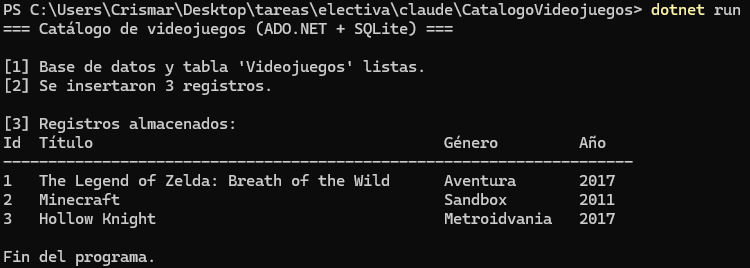

# Catálogo de videojuegos — ADO.NET con SQLite

Autor: **CRISMAR VERGARA**

## Descripción
Programa de consola en C# que usa **ADO.NET** y **SQLite** (`Microsoft.Data.Sqlite`) para:

1. Crear una base de datos SQLite (`videojuegos.db`).
2. Crear la tabla `Videojuegos` (Id, Titulo, Genero, Anio).
3. Insertar tres registros con `SqliteCommand` y parámetros.
4. Consultar y mostrar los registros con `SqliteDataReader`.

Todos los recursos (`SqliteConnection`, `SqliteCommand`, `SqliteDataReader`) se administran con `using`.

## Requisitos
- [.NET 8 SDK](https://dotnet.microsoft.com/download)
- Conexión a internet la primera vez (para descargar el paquete NuGet).

## Cómo ejecutar
```bash
git clone https://github.com/crismarvergara0916-bot/CatalogoVideojuegos.git
cd CatalogoVideojuegos
dotnet run
```

## Estructura
```
CatalogoVideojuegos/
├── CatalogoVideojuegos.csproj
├── Program.cs
├── README.md
└── capturas/
```

## Capturas de pantalla
<!-- Guarda tus capturas en la carpeta "capturas/" y enlázalas aquí -->

